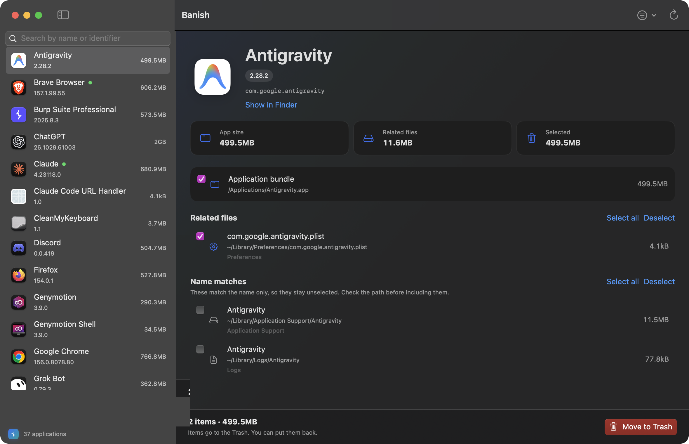
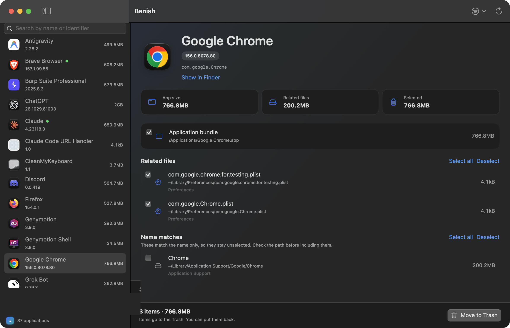
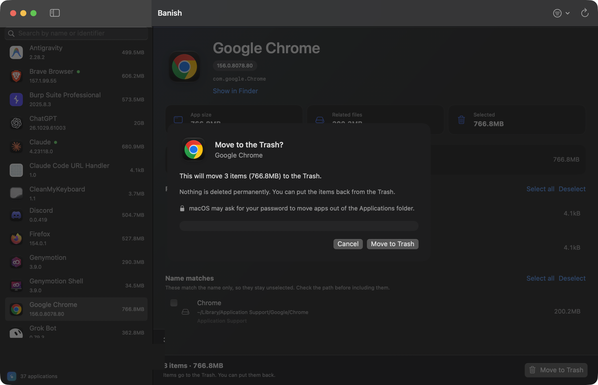
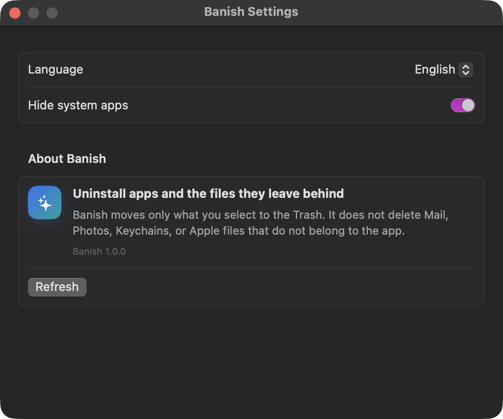

<p align="center">
  <a href="./README.md"></a>
  <a href="./docs/i18n/ar.md"></a>
  <a href="./docs/i18n/es.md"></a>
  <a href="./docs/i18n/fr.md"></a>
  <a href="./docs/i18n/de.md"></a>
  <a href="./docs/i18n/pt.md"></a>
  <a href="./docs/i18n/tr.md"></a>
  <a href="./docs/i18n/zh.md"></a>
  <a href="./docs/i18n/ja.md"></a>
  <a href="./docs/i18n/ko.md"></a>
</p>

# Banish

**The app, and everything it left behind.**

Dragging an app to the Trash only removes the icon. Preferences, caches, containers, logs, and launch agents stay in your Library. They keep using disk space, and they show up again the next time you install the app.

Banish finds those files, shows them before anything moves, and sends only what you select to the Trash. You can put every item back. Nothing is deleted permanently.

<p>
  
</p>

## What you see

The sidebar lists installed apps with version and size. A green dot means the app is running. Search takes a name or a bundle identifier, such as `com.google.Chrome`.

Select an app and three numbers appear:

- The size of the app itself.
- The size of the related files Banish found.
- The size of what is actually selected and will go to the Trash.

Under those cards are two groups. **Related files** are matched by bundle identifier and start selected. **Name matches** only share the app’s name, so they stay unchecked until you look at the path.

<p>
  
</p>

## Nothing moves until you confirm

**Move to Trash** opens a confirmation sheet with the item count and the size. The Trash button is not the default button, so Return does not confirm by accident.

Apps inside `/Applications` belong to macOS. A normal move is refused even when the app is yours. The sheet says that your password may be required. After you confirm, macOS asks once, and Banish moves the selection into the Trash.

<p>
  
</p>

Cancel the password dialog and the move stops. Anything that did not move stays where it was. Anything that reached the Trash can be put back.

## Where it looks

Banish does not scan the whole disk. It looks in the known Library folders, one or two levels deep.

| Place | Examples |
| --- | --- |
| Preferences | `~/Library/Preferences` |
| Support, caches, logs | Application Support, Caches, Logs |
| Containers | Containers and Group Containers |
| Web data | Cookies and WebKit, when the identifier matches |
| Startup | Launch Agents and Launch Daemons |
| Saved state | Saved Application State |

A strong match uses the bundle identifier, not a similar name. `com.foo.app` does not collect `com.foo.application` or `com.foo.app2`. `Google/Chrome` can belong to Chrome. `Google/Earth` and `Other/Chrome` do not, just because one word is shared.

## What it will not touch

These places are refused even if a search would otherwise notice them:

- System locations such as `/System`, `/usr`, `/bin`, and `/private`.
- Your documents, Desktop, Downloads, pictures, and music.
- Mail, Messages, Photos, Safari, Keychains, Calendar, and Notes.
- `~/.ssh`, and the Trash itself as something to delete.
- Symbolic links. Banish does not follow a link out of the folder.
- Banish itself. The running copy cannot move its own app.

Core Apple apps, including Finder, Safari, and Mail, stay locked. Optional Apple apps such as Keynote, Pages, and Numbers can be removed, with a clear warning. System apps are hidden at first. Show them from the View menu or from Settings.

## Permissions

**An administrator password** is asked only when macOS refuses to move an app out of the Applications folder. The dialog is the system dialog, and it names Banish.

**Full Disk Access** is optional. It lets Banish read containers and caches that macOS otherwise hides. Without it, the app list still works, and a banner appears when a folder cannot be read.

System Settings → Privacy & Security → Full Disk Access

## Language inside the app

The window follows the language of your Mac, including right to left for Arabic. Settings can pin Arabic or English on their own.

<p>
  
</p>

## Build it

macOS 14 or later, and Swift 6. No third-party libraries.

```bash
./Scripts/build-app.sh
open build/Banish.app
```

Or:

```bash
make app
make run
```

`make test` checks the rules underneath the window: which paths may move, which files belong to an app, and how the password step is built without ever touching a path the policy refused.

The signed app is `build/Banish.app`. Build folders are not part of this repository.
